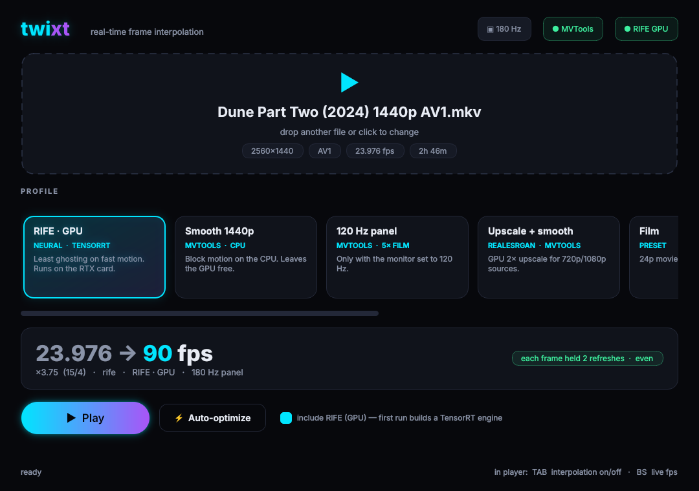

# twixt

Real-time video frame interpolation for playback — the SVP Pro workflow, built
from open parts. Point it at a 24 fps film and it plays at your monitor's
refresh rate, generating the in-between frames as it goes.

Measured on the machine it was built on: a 1920×800 film plays **23.976 → 71.9 fps**
with 5 dropped frames a second and playback holding exactly real time. Two of
every three frames you see were invented.

```
input  = 23.976 fps
output = 71.9 fps    (3x)
```

## How it works

Three layers, the same shape SVP uses:

| Layer | What it does | Here |
|---|---|---|
| Player | Decodes, presents, syncs to the display | **mpv** |
| Filter host | Runs a processing graph inside the playback pipeline | **VapourSynth** |
| Motion engine | Invents the intermediate frames | **RIFE / MVTools / SVPflow** |

`twixt` is the manager on top: it probes the file, works out the exact frame
ratio, generates a VapourSynth script for that specific combination, and starts
the player with the filter attached.

Interpolation happens *during playback*. Nothing is re-encoded and nothing is
written to disk.

### The three backends

- **`mvtools`** — classic block motion estimation, the open ancestor of the
  algorithm SVPflow refined: `Super` → `Analyse` → `Recalculate` → `FlowFPS`.
  CPU only. **Measured fastest on this machine by a wide margin.**
- **`rife`** — neural optical flow (RIFE 4.x) via [vs-mlrt] on TensorRT. Better
  at occlusions and non-rigid motion, where block matching tears — but far more
  expensive. See the measurements below before relying on it for playback.
- **`svpflow`** — the real SVP libraries, used only if you already have them
  installed, so an existing SVP install can be driven from here.

Which one wins is **not** predictable from the hardware. Run `twixt tune` — it
measures every installed backend and tells you which to use.

## Measured on this machine

RTX 4070 SUPER, i5-14600K, 180 Hz panel.

**Real playback**, 1920×800 film, read from mpv's own counters mid-film:

| cap | output | dropped/sec | playback speed |
|---|---|---|---|
| 120 | 119.9 fps | 119.9 | 95% — stutters |
| 96 | 95.9 fps | 95.8 | 96% — stutters |
| **72** | **71.9 fps** | **5.1** | **100% — clean** |

At 120 the frames are all generated correctly; the player simply cannot present
them in time, so it falls behind. 72 fps (3×) is where it keeps up.

**Filter throughput** measured separately with `tune` (vspipe, no player) at
1080p reported 120–134 fps for the same settings. That number is optimistic:
it excludes decoding, presentation and sync overhead, which is where the rest
of the budget goes. Treat `tune` as an upper bound and confirm with real
playback.

### Backends

| Backend | Result here |
|---|---|
| mvtools | 72 fps real time. **The one that works.** |
| rife (TensorRT) | ceiling ~34 fps output — never reached real time |
| svpflow | only if you already have SVP installed |

**RIFE did not reach real time**, the opposite of what was expected from the
GPU. During inference the card sits at ~13% utilisation and 210 MHz idle clocks
drawing 16 W. Raising concurrent frame requests saturates at 2 (25 → 38 fps,
flat after), CUDA graphs and fp16 output changed nothing, and `--filter-time`
attributes only ~21% of wall time to the inference node. The work arrives in
bursts too small to keep the card busy — pipeline overhead, not GPU compute.
`scale`, the usual speed lever, reports "not supported" for this model and no
`lite` model ships in the pack.

MVTools is CPU-only, which also leaves the GPU completely free.

## Smoothness fixes (2026-11-04)

What was making 1440p stutter and ghost. Every item below comes from the
documentation or source of the component involved, not from guessing:

| Problem | Cause | Fix |
|---|---|---|
| 120 fps "laggy" on the 180 Hz panel | 180 / 120 = 1.5, so frames are held 1, 2, 1, 2 refreshes: judder even when every frame is on time (mpv documents the same 2-3-2-3 effect for 24p on 60 Hz) | Target snaps to `display / k` (180, 90, 60). For 120 set the monitor to 120 Hz; for 144, 144 Hz. `--no-snap` turns snapping off |
| `twixt-1440p.json` said 90 fps | it actually asked for `rate_fixed: 120` | now 90 |
| Hitch on fast motion | `thscd1=200` / `thscd2=90`, tighter than MVTools' defaults 400 / 130 (51%). Fast pans counted as scene cuts, and on a cut FlowFPS **repeats the previous frame** | MVTools defaults |
| GPU at ~13% with RIFE | `vsmlrt.RIFE`'s video-player path for fractional rates runs three Python `FrameEval` callbacks per **output** frame (one builds a new `BlankClip` each time), so everything waits on the Python GIL | own native graph: `SelectEvery` / `Interleave` / `Loop` + one `RIFEMerge`, with no per-frame Python. Also fp16 RGB (half the bytes of RGBS) and padding that matches each model's size requirement |
| Memory and slow seeks | mpv **multiplies** `buffered-frames` by `concurrent-frames`: 28 x 20 = 560 held 1440p frames (3 to 6 GB) | window sized to what the requests can reach |
| Extra work at the output rate | the 8-bit MVTools result was converted back to the 10-bit source format on every output frame, which restored nothing | sent to mpv as 8-bit |
| Artifact masking backwards | FlowFPS `ml`: greater = *weaker* mask. `strong` was the weakest | mapped the right way round |

**Ghosting and block tearing on fast motion** are built into block-matching
interpolation (MVTools, and SVP's own block engine): 32 px blocks moving as
rigid pieces, plus blended fallbacks where vectors fail. The fix that
competing tools use is neural interpolation on the GPU. SVP's RIFE mode runs
this same vs-mlrt / TensorRT stack. Now that the GPU is no longer starved, try it:

```bash
python -m twixt tune "film.mkv" --backend rife
```

Then drag the file onto `play-rife.cmd`. The first run on a new frame size
builds a TensorRT engine, which takes minutes once. Re-run `bootstrap.ps1` so the
`akarin` plugin is installed. Without it, scene-cut selection falls back to a
Python callback.

### Round 2: measuring what you actually see

- **`twixt check`** plays the file for real (fullscreen) and judges it from
  mpv's own counters: dropped frames, mistimed frames, delayed frames,
  playback speed, and `vsync-ratio`, the number of refreshes each frame
  is held. 2.00 at 90 fps on 180 Hz is perfect. 1.50 is the 120-on-180 judder.
  `--auto` tries 180, then 90, then 60, and saves the highest rate that plays with zero drops:

  ```bash
  python -m twixt check "film.mkv" --profile twixt-1440p.json --auto
  ```

  `tune` (vspipe, filter only) is an estimate. `check` is the real result.
- **`tune` picks quality too.** At each even-cadence rate it climbs from
  cheapest to most accurate (`large` to `small` blocks, whole-pixel to
  half-pixel vectors) and keeps the best setting that still holds. Before,
  it stopped at the first rate that held and kept the coarsest grid.
- **Hardware decoding uses `nvdec-copy`**, which mpv's manual calls the recommended method on
  Nvidia. Other GPUs fall back to `auto-copy`.
- **RIFE's scene-cut detector runs on a 960 px copy.** It only outputs a
  per-frame cut flag, so the full 1440p motion search was wasted CPU.
- `--threads N` overrides how many frames are in flight through the filter,
  so you can test it with `check`.

**Known limit: seeking.** mpv rebuilds the VapourSynth core on every seek
(`vf_vapoursynth_reset` → `destroy_vs` in mpv's source), so with RIFE the
TensorRT engine reloads after each jump. That pause after a seek comes
from the player, and the script cannot keep the engine across it.

## Install

```powershell
powershell -ExecutionPolicy Bypass -File bootstrap.ps1
```

Everything lands in `.\runtime\`. Nothing touches the registry, the system PATH,
or Program Files — delete the folder to uninstall. Check it worked:

```bash
python -m twixt doctor
```

## Use

Drag a video file onto `play.cmd`. That is the whole workflow.

Or from a terminal:

```bash
python -m twixt play "D:\moviesilm.mkv" --profile fast --cap 72
```

While it plays:

| key | does |
|---|---|
| `TAB` | toggle interpolation on/off, back to back |
| `BS` | show live input fps, output fps and dropped frames |

Before committing to a long film, find out what your machine can actually
sustain. `tune` measures real configurations and tells you the exact command to
run:

```bash
python -m twixt tune "D:\movies\film.mkv"
```

```
  backend   grid        target   achieved   verdict
  ------------------------------------------------------
  rife      -           180.0p      24.8p   too slow
  rife      -            48.0p      34.3p   too slow
  mvtools   large       180.0p     134.6p   too slow
  mvtools   large       120.0p     133.2p   real time
  mvtools   medium       96.0p     106.6p   real time

  best: 120.0 fps (5x source) on mvtools

  python -m twixt play "film.mkv" --backend mvtools --grid large --cap 120
```

To measure one specific configuration instead:

```bash
python -m twixt bench "D:\movies\film.mkv" --cap 120
```

**Why you have to measure.** Throughput does not scale the way you would
expect. Motion estimation is charged per *source* frame pair, so a higher
multiplier spreads that fixed cost over more output frames. On this machine
MVTools at 1080p produced **55 fps of output when targeting 180**, but only
**43 fps when targeting 48** — asking for less was slower. A single benchmark
therefore cannot be extrapolated to a different target, which is what `tune`
exists to handle.

### The manager window



Double-click **`gui.cmd`**, or drag a video onto it. The first run installs PySide6 (Qt) on its own.

- **Drop a video** to see its resolution, codec, fps and length.
- **Pick a profile card**: Optimized, RIFE GPU, Smooth 1440p, 120 Hz panel, Upscale, or the presets.
- The readout shows the exact rate that will play and how many refreshes each
  frame is held. Green means even cadence; amber means it will judder.
- **▶ Play** starts mpv. Press it again to stop.
- **⚡ Auto-optimize** runs `tune` (filter speed) and then `check --auto` (real fullscreen
  playback), streams both into the console, and selects the resulting
  **Optimized** card (`twixt-checked.json`).

```bash
python -m twixt gui ["film.mkv"]
```

Without PySide6 it falls back to the old Tk window. The player runs at
above-normal priority on Windows, so background apps can't steal its vsync.

### Common adjustments

```bash
python -m twixt play film.mkv --profile anime        # cel animation, tight cut detection
python -m twixt play film.mkv --cap 120              # stop at 120 fps instead of 180
python -m twixt play film.mkv --multiplier 2         # exactly double, ignore the display
python -m twixt play film.mkv --backend rife         # neural, if tune says it holds
python -m twixt play film.mkv --masking strong       # fewer artifacts, less smoothness
python -m twixt play film.mkv -- --start=00:10:00    # anything after -- goes to mpv
```

### Profiles

| Name | For |
|---|---|
| `film` | 24p live action. The default. |
| `anime` | Cel animation: held frames, hard lines, frequent cuts. |
| `sports` | Fast pans and unpredictable motion. Widest search. |
| `fast` | Coarsest grid — the highest frame rate this machine can hold. |
| `neural` | RIFE. Best quality, much slower; measure with `tune` first. |
| `4k` | Estimates motion on a smaller copy and caps output for 2160p. |
| `max-quality` | Finest grid and full refinement. Expect to lower the cap. |

`python -m twixt profiles` lists them with their settings. Save a tweaked one
from the GUI, then load it with `--profile myprofile.json`.

## Inspecting and tuning

The generated VapourSynth script is plain readable Python. Dump it, edit it,
run it directly through `vspipe`:

```bash
python -m twixt script film.mkv --profile anime -o tuned.vpy
```

Every knob is in the `CFG` dict at the top.

## When it stutters

Run `twixt tune` first — it answers this by measurement rather than guesswork.

The levers, in rough order of effect (measured with MVTools at 1080p on this
machine):

1. **`--grid`** — by far the biggest lever. At 1080p: `small` ~60 fps →
   `medium` ~110 fps → `large` ~134 fps. Coarser grids track fine detail less
   precisely but cost far less.
2. **`--profile 4k`** — estimates motion on a downscaled copy, which is close to
   free at 2160p.
3. **`--cap`** — but see the note above; a lower target is not reliably faster.
4. **`--masking strong`** — falls back to blending sooner, skipping work on the
   hardest regions.

`headroom` under 1.0× means frames will be dropped.

## Known limitation: other players

`twixt` drives its own bundled mpv. It does **not** hook into MPC-HC, VLC or
PotPlayer, which is how SVP works.

The MPC-HC path is implemented (`twixt install-mpchc`) and every piece of it
checks out individually — AviSynth+ and MVTools install, the generated `.avs`
script is valid, the DirectShow filter registers and instantiates cleanly. But
MPC-HC will not insert an external filter that was written to its registry
config rather than added through its own dialog. Verified failing: 0% CPU
during playback and a probe script that never executed.

The VapourSynth build of the same filter is a dead end regardless — it has to
start an embedded Python interpreter inside the player process, and that
deadlocks on filter creation (reproduced outside any player).

If you want this working, the missing piece is whatever additional state
MPC-HC writes when a filter is added through **Options → Playback → External
Filters**. Pull requests welcome.

## What this is not

This is not a decompilation or reimplementation of SVPflow. SVP's motion vector
engine is closed source and its exact behaviour is not reproducible from the
outside. What is reproduced is the *architecture* and the *result*: real-time
interpolated playback with per-content profiles, driven by a manager that
generates the filter graph per file.

The MVTools backend is the same family of algorithm SVPflow derives from, so its
output is close in character. It is not bit-identical, and no claim is made that
it is.

## Layout

```
twixt/
  profiles.py   profile model, presets, frame-ratio maths
  engine.py     generates the VapourSynth script (the interpolation itself)
  detect.py     runtime discovery, display refresh, ffprobe source probing
  player.py     mpv launch, IPC control, benchmarking
  gui.py        manager window
  cli.py        command line
tests/
  mockvs.py     fake VapourSynth so the filter graph can be tested anywhere
```

Run the tests with `python tests/test_engine.py`, `python tests/test_player.py`, `python tests/test_profiles.py`, and `python tests/test_rife_graph_realvs.py`. The last one runs the RIFE graph in real VapourSynth (`pip install vapoursynth`) and skips if it is missing.

[vs-mlrt]: https://github.com/AmusementClub/vs-mlrt
